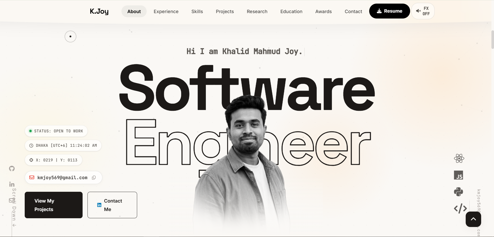
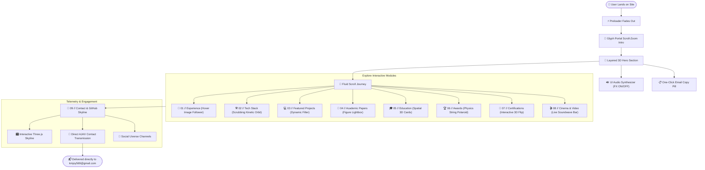
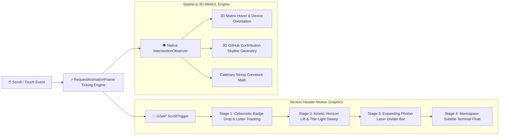

<div align="center">

# ⚡ KHALID MAHMUD JOY
### Awwwards-Tier Interactive Engineering & AI Research Portfolio

<p align="center">
  
</p>

[](http://localhost:3000/)
[](https://greensock.com/)
[](https://web3forms.com/)
[](#responsive-architecture)
[](#)

---

### 🌟 Hero Experience Showcase
<br/>

<p align="center">
  
</p>

<p align="center">
  <em>High-impact hero with depth-layered typography ("Software Engineer"), spatial portrait positioning, interactive audio feedback, and direct email copy telemetry.</em>
</p>

---

</div>

## 📑 Table of Contents
- [Overview & Vision](#-overview--vision)
- [System Architecture & Visual Flowcharts](#-system-architecture--visual-flowcharts)
  - [Interactive User Journey](#1-interactive-user-journey-flowchart)
  - [Motion Graphics & Kinetic Engine Pipeline](#2-motion-graphics--kinetic-engine-pipeline)
- [Directory & File Architecture](#-directory--file-architecture)
- [Key Features & Creative Modules](#-key-features--creative-modules)
  - [1. Section Header Kinetic Motion Graphics](#1-section-header-kinetic-motion-graphics)
  - [2. Interactive 3D GitHub Skyline Canvas](#2-interactive-3d-github-skyline-canvas)
  - [3. Direct Message Telemetry (Web3Forms)](#3-direct-message-telemetry-web3forms)
  - [4. Compact Holographic Research Cards](#4-compact-holographic-research-cards)
  - [5. Physics-Based Polaroid Award Carousel](#5-physics-based-polaroid-award-carousel)
- [Technology Stack](#-technology-stack)
- [Local Development & Quickstart](#-local-development--quickstart)
- [Deployment](#-deployment)
- [Contact & Connect](#-contact--connect)

---

## 🧭 Overview & Vision

This repository houses the personal portfolio and digital laboratory of **Khalid Mahmud Joy** — Full-Stack Software Engineer, Machine Learning Researcher, and Creative Technologist based in Dhaka, Bangladesh.

The website is engineered from scratch without bulky frontend frameworks, achieving **sub-second paint times, 60 FPS hardware-accelerated animations**, and an award-winning editorial aesthetic inspired by Awwwards, Apple, and Linear.

### Core Metrics:
- ⚡ **Zero Framework Overhead:** Pure HTML5, modern CSS3, and modular vanilla JavaScript.
- 🎨 **Kinetic Choreography:** GSAP 3.12, ScrollTrigger, and custom spring-physics easing curves.
- 📐 **Adaptive Spatial Layouts:** Fluid viewport clamps (`clamp()`) guaranteeing flawless visual hierarchy from 320px mobile screens to ultra-wide 4K displays.
- 🔒 **Serverless Telemetry:** Asynchronous AJAX form transmission with automated honeypot bot defense.

---

## 📊 System Architecture & Visual Flowcharts

### 1. Interactive User Journey Flowchart



---

### 2. Motion Graphics & Kinetic Engine Pipeline



---

## 📂 Directory & File Architecture

```text
khalidjoy/
├── 📄 index.html              # Core single-page application & master stylesheet
├── 📄 server.js                # Lightweight Node.js local HTTP server (Zero dependencies)
├── 📄 hero-section.png         # High-resolution screenshot of hero section
├── 📄 Khalid Mahmud Joy.pdf    # Official downloadable curriculum vitae (Resume)
├── 📄 my_image_nobg.png        # Transparent portrait asset with depth mask
├── 📄 netlify.toml             # Netlify edge deployment configuration
│
├── 📁 assets/                  # Core runtime 3D & WebGL scripts
│   └── 📄 skyline.js           # Three.js GitHub 3D Skyline procedural city engine
│
├── 📁 awards image/            # High-resolution imagery for honors & polaroids
│   ├── ewu hackathon.jpg
│   ├── ewu scholarship.png
│   ├── national science fair.jpg
│   └── ...
│
├── 📁 Certificate/             # Professional certifications & course credentials
│   ├── Google_Digital_garage_certificate.png
│   └── ...
│
├── 📁 education/               # Academic institutions & badge assets
│   ├── East West University.png
│   └── ...
│
├── 📁 experience/              # Enterprise logos for interactive career timeline
│   ├── amabalaIT logo.png
│   ├── caretutors.jpg
│   └── ...
│
├── 📁 paper/                   # Research publications & experimental figures
│   ├── MRI.webp                # Brain MRI pathology figure (DINOv3 + YOLOv12)
│   └── face detection.jpg      # TEALD-X CCTV temporal framework figure
│
└── 📁 project poster/          # Featured engineering project showcase cards
    ├── AI agent.png
    ├── docufast.png
    └── ...
```

---

## ✨ Key Features & Creative Modules

### 1. Section Header Kinetic Motion Graphics
Every section header is governed by an award-winning choreographed entrance:
- **Cybernetic Telemetry Badge:** Springs into place with elastic overshoot (`back.out(1.6)`), glass pill backdrop, and interactive icon tilt on hover (`18°` rotation).
- **Kinetic Horizon Lift:** Titles elevate smoothly using Apple-style cubic inertia (`power4.out`), preserving inner gradient text intact.
- **Photon Laser Divider:** An amber energy beam (`scaleX: 0 → 1`) centered under the title that flares into a luminous glow on hover.
- **Terminal Subtitle Float:** Staggered monospace description floating into view seamlessly.

### 2. Interactive 3D GitHub Skyline Canvas
- Procedurally generates a 3D isometric skyline representing GitHub commit telemetry.
- Dynamic responsive projection adjusts camera zoom factor (`0.58`) and stage bounds dynamically to guarantee full visibility on mobile devices.
- Orbit controls with rotation, drag, pan, and real-time lighting highlights.

### 3. Direct Message Telemetry (Web3Forms)
- **Zero Server Setup Needed:** Integrates Web3Forms API to route incoming inquiries straight to `kmjoy569@gmail.com`.
- **Live User Feedback:** Interactive loading state (`Transmitting...` with spinner), green confirmation alert banner, and audio feedback chime.
- **Honeypot Anti-Spam:** Automated hidden botcheck catches scrapers silently.
- **Mailto Fallback:** Instant fallback ensures no message is lost if network limits are reached.

### 4. Compact Holographic Research Cards
- **Unified Side-by-Side Architecture:** Replaces clunky vertical stacks with a unified glass capsule.
- **Left Capsule:** High-tech micro-figure thumbnail with scanlines, laser sweep, and metric badges (`94.08% mAP`).
- **Right Space:** Populated with `MANUSCRIPT PREP` status pills, technical summaries, and tech stack tags.
- **High-Res Lightbox Modal:** Fullscreen figure modal with telemetry stats on click.

### 5. Physics-Based Polaroid Award Carousel
- Realistic suspended rope simulation using dynamic SVG catenary curves.
- Draggable cards with perspective tilt, active indicator counter, and touch drag support.

---

## 🛠️ Technology Stack

| Category | Technologies / Libraries |
| :--- | :--- |
| **Markup & Core** | HTML5 Semantic Architecture, JetBrains Mono, Syne, Inter |
| **Styling & FX** | CSS3 Variables, Backdrop Filter, Glassmorphism, Fluid Clamps |
| **Animation Engine**| GSAP 3.12.2, ScrollTrigger, TextPlugin, Web Audio API |
| **3D & Graphics** | Three.js Procedural Canvas, Dynamic SVG Catenary Math |
| **Icons & Media** | FontAwesome 6.5, Devicon SVG CDN |
| **Backend & Mail** | Node.js Built-in HTTP, Web3Forms Serverless API |
| **Deployment** | Netlify, GitHub Pages, Vercel Ready |

---

## 💻 Local Development & Quickstart

Clone the repository and run the local environment in seconds:

```bash
# 1. Clone this repository
git clone https://github.com/Joy5691/khalidjoy.git

# 2. Enter directory
cd khalidjoy

# 3. Launch the lightweight zero-dependency local server
node server.js
```

Open your browser to:
- **Local machine:** [http://localhost:3000/](http://localhost:3000/)
- **Mobile device (same Wi-Fi):** `http://<YOUR_LAN_IP>:3000/`

---

## 🚀 Deployment

### Option 1: Netlify (Recommended)
This repository contains a pre-configured [`netlify.toml`](./netlify.toml). Simply import the repository in Netlify or run:
```bash
npx netlify deploy --prod
```

### Option 2: GitHub Pages
Since the portfolio is 100% serverless, push to the `main` branch and enable **GitHub Pages** under repository **Settings > Pages > Deploy from branch (root)**.

---

## 📬 Contact & Connect

- **Portfolio:** [khalidjoy.me](http://localhost:3000/)
- **Email:** [kmjoy569@gmail.com](mailto:kmjoy569@gmail.com)
- **GitHub:** [@Joy5691](https://github.com/Joy5691)
- **LinkedIn:** [Khalid Mahmud Joy](https://linkedin.com/in/khalid-mahmud-joy-4a0418278/)

<br/>

<div align="center">
  <sub>Designed &amp; Hand-Coded with Precision by <strong>Khalid Mahmud Joy</strong> &copy; 2026. All Rights Reserved.</sub>
</div>
